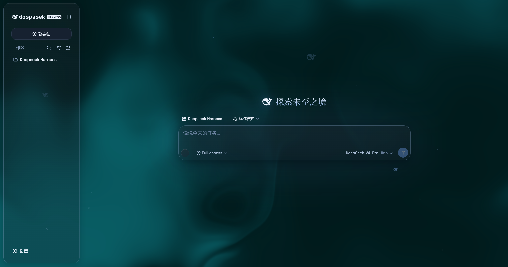
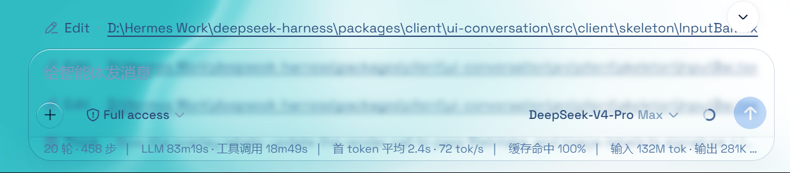

># @deepseek-ai/dsh-client-ui-aqua

**Aqua** 是一层高自由度的玻璃质感主题（glassmorphism），套在 DeepSeek Harness 网页端：顶栏、侧边栏、输入框、统计行、轨迹视图全部变成磨砂玻璃片。关掉总开关即完全还原原生界面，不改 DSH 任何一行源码。







## ⚠️ 重要：本仓库是修改版，不是原创

> **署名 / Credits**
> - 原作者：**WYH66666666** — https://github.com/WYH66666666/DSH-Transparent-UI-Plugin
> - 0.1.1-rc.2 适配：**du-u-uck** — https://github.com/du-u-uck/DSH-Transparent-UI-Plugin
> - v0.2.x 适配：**acdsh4869** — https://github.com/acdsh4869/dsh-aqua-theme
> - 本仓库：**thexiaohu** — 在 acdsh4869 适配版基础上做了代码清理与功能精简

> **修改声明 / Modification Notice**
>
> 本仓库是原作品的**修改 / 适配版**，不是原创。
> - 原作者（Original author）：**WYH66666666**
> - 修改内容（Changes）：DeepSeek Harness **0.2.x** 兼容适配 + 代码清理与功能精简
> - 修改日期（Date of modification）：**2026-10**
> - 维护仓库（Maintained at）：`thexiaohu/dsh-aqua-theme`
> - 许可（License）：**AGPL-3.0**（沿用上游许可，必须保留）

## ⚠️ 源码与构建产物不同步（重要）

**本仓库的 `lib/client.js` 是修改后的构建产物，而 `src/` 目录仍是上游原始源码。**

这意味着：

| 你的操作 | 结果 |
|---|---|
| 直接使用 `lib/` | ✅ 得到清理后的版本（推荐） |
| 运行 `pnpm run bundle` 重新构建 | ⚠️ **会覆盖清理后的 `lib/`，恢复成上游原始版** |

如果你要重新构建，请先明白这一点。清理的内容见下方「本仓库的修改」。

## 本仓库的修改

在 `acdsh4869/dsh-aqua-theme` 基础上做了以下改动（**仅修改 `lib/client.js` 构建产物**）：

### 删除的功能

| 项目 | 原因 |
|---|---|
| 流体 WebGL 背景 | 该 WebGL 层在 `theme/change` 时丢失 token 覆盖，会在背景上画出一块实心色板 |
| 壁纸 / 视频背景 | 无 UI 入口，`background` 恒为 `"fluid"`，整条链路不可达 |
| 模式选择器（云母/兼容） | 用户只需云母效果 |
| 「恢复默认效果」按钮 | 保留设置值即可，不需要重置 |
| 背景亮度滑块 | 无 UI 入口 |
| 辉光颜色深浅滑块 | 保留色调滑块即可 |

### 新增的功能

| 项目 | 说明 |
|---|---|
| 「主题设置」统一标题 | 所有控件归到一组，不再有多个小标题 |
| 玻璃模糊度 / 玻璃磨砂度 | 滑块名称更明确 |
| 鼠标辉光色调 | 明确该滑块控制辉光而非流体 |
| 中鱼数量 / 小鱼数量 / 鱼尺寸 | 三个独立滑块，上限 40 / 40 / 120px |
| **大鱼颜色 / 中小鱼颜色** | **两行独立配置**，各有品牌色块 + RGB 圆盘取色器 |
| **每行内联透明度滑块** | 颜色行右侧直接显示百分比，拖动即时生效 |
| 复选框式开关 | 粒子鲸鱼 / 小鱼 / 网状交互 / 鼠标辉光 / 悬停下压 |

### 颜色配置

大鱼和中小鱼的颜色**完全独立**：

```
大鱼颜色     [■][■][🎨]  [━━━━●━━] 100%
中小鱼颜色   [■][■][🎨]  [━━━━●━━] 100%
```

| 控件 | 说明 |
|---|---|
| 色块 1 | DeepSeek 蓝 `#4d6bfe` |
| 色块 2 | Harness 蓝 `#1b4f9e` |
| 调色板图标 | 打开 RGB 圆盘取色器 |
| 滑块 | 该行鱼的透明度（0–100%，默认 100%） |

**RGB 圆盘取色器**：

- 圆盘角度 = 色相，半径 = 饱和度
- 点击或拖动直接取色（rAF 节流，拖动不卡）
- 下方 R / G / B 三个数字输入框，0–255
- 左侧圆点实时预览当前颜色
- 三者双向同步

### 修复的问题

| 问题 | 修复 |
|---|---|
| 鼠标移到输入框左侧时面板上移 | `spot` 选择器从 `[data-dsh-inputbar]` 改为 `[data-composer-card]`，消除 spot 与 visual 的范围差 |
| 鱼群分布不均、成团 | 改用 Mitchell's Best-Candidate（蓝噪声）算法，无格点结构、无空洞 |
| 小鱼集中在下半区 | 小鱼槽位改为步进分配，均匀穿插 |
| 网格线几乎不可见 | 透明度从 `.10/.20` 提升到 `.22/.42` |
| 鲸鱼粒子偏淡 | 浅色模式 RGB 基准加深，亮度下限从 `.2` 提到 `.52` |
| 小鱼太小 | 尺寸提升，透明度从 `0.22` 提到 `0.55` |
| 网格绘制卡顿 | 单路径绘制 + 平方距离比较 + dpr 从 2 降到 1.5 |
| 辉光卡顿 | 改用 CSS 变量 `--gx/--gy`，避免每次 `pointermove` 重写 `background-image` |
| 鲸鱼卡顿 | 平方距离提前返回 + `alpha` 取整替代 `toFixed(3)` |
| **大鱼颜色不跟随设置** | 鲸鱼原本用硬编码 RGB，现改读 `--dsh-aqua-whale-color` |
| **大鱼颜色偏离设定值** | 光照调制从 `52%–112%` 压平到 `88%–106%`，偏离度降低 80% |
| **颜色设置重启后重置** | `readSetting` 对颜色键误用 `Number()`，把 `#a1b2c3` 转成 `NaN`；改为按字符串校验 |
| **鱼颜色发虚** | 透明度默认值从 55% 提到 100%，映射下限从 `.12` 起 |
| **切换深浅主题后玻璃失效** | `theme/change` 回调补上 `applyTokens()`，并加 `reapplyingTokens` 防递归守卫 |
| **发送键 hover 闪烁** | 高光从 `box-shadow` 改为 `pointer-events:none` 的 `::after` 覆盖层 |
| **取色器圆盘变成圆角方块** | 所有内联样式加 `all:initial` 重置宿主 div 规则 |
| **取色器拖动卡顿** | `pointermove` 用 `requestAnimationFrame` 节流 |

## 特性

- **玻璃材质**：模糊度、磨砂度可调，云母模式下布局变为悬浮玻璃卡片
- **环境装饰**：粒子鲸鱼、小鱼群、网状交互、鼠标辉光、悬停下压，均可单独开关
- **鱼群可调**：中鱼/小鱼数量、鱼尺寸、两套独立颜色 + 透明度
- **一键开关**：关闭即完全还原原生界面，无残留

## 安装

### 前提

- DeepSeek Harness **`0.2.0-rc.2`** 或更高（桌面端 v0.22.3+）
- 已至少启动过一次 DSH（profile 目录已初始化）

### 重要：profile 名称

DSH 的 profile 决定插件装到哪里。请先确认你的 profile：

| 你用的版本 | profile 名称 |
|---|---|
| **桌面版**（Electron 应用） | `desktop` ← 脚本默认 |
| 浏览器版（`dsh web`） | `web` |

不确定的话，看一眼 `%USERPROFILE%\.dsh\profiles\` 下的目录名。

### 方式一：一键脚本（推荐）

**桌面版**（默认 `-Profile desktop`）：

```powershell
irm https://github.com/thexiaohu/dsh-aqua-theme/raw/main/install.ps1 -OutFile install.ps1
.\install.ps1
```

**浏览器版**，加 `-Profile web`：

```powershell
.\install.ps1 -Profile web
```

**从本地文件夹安装**（可实时改代码）：

```powershell
.\install.ps1 -Source '你的绝对路径\dsh-aqua-theme'
```

脚本会做四件事，且**重复运行安全**：

1. 从 GitHub 下载最新版（无 Release 时用 `main` 分支）
2. 把包放到 `%USERPROFILE%\.dsh\plugins\@deepseek-ai\dsh-client-ui-aqua`
3. 在 profile 的 `node_modules` 里建 junction 软链
4. 把插件登记进 profile 的 `package.json`：
   - `dependencies` 加 `link:../../plugins/@deepseek-ai/dsh-client-ui-aqua`
   - `dsh.profile.bundles` 加入 `@deepseek-ai/dsh-client-ui-aqua`

> **为什么不用 `cordis.patch.yml`？**
> DSH 的加载器（`dsh-app-boot` 的 `loadProfileDirectory`）第一步读 profile 的
> `package.json`，取 `dsh.profile.bundles` 列表，然后才应用 `cordis.patch.yml`
> 作为用户层。只写 patch 文件、不改 `package.json`，插件不会被加载。

### 方式二：手动安装

**Windows（PowerShell）：**

```powershell
$plugin = "$env:USERPROFILE\.dsh\plugins\@deepseek-ai\dsh-client-ui-aqua"
$profile = "$env:USERPROFILE\.dsh\profiles\desktop"   # 浏览器版改成 web

# 1. 下载包
git clone https://github.com/thexiaohu/dsh-aqua-theme.git $plugin

# 2. 建软链
New-Item -ItemType Junction -Force `
  -Path "$profile\node_modules\@deepseek-ai\dsh-client-ui-aqua" `
  -Target $plugin

# 3. 登记到 package.json（手动编辑，加两处）
#    dependencies 里加：  "@deepseek-ai/dsh-client-ui-aqua": "link:../../plugins/@deepseek-ai/dsh-client-ui-aqua"
#    dsh.profile.bundles 里加：  "@deepseek-ai/dsh-client-ui-aqua"
```

**macOS / Linux：**

```sh
export DSH_HOME="$HOME/.dsh"
PROFILE=desktop    # 浏览器版改成 web

git clone https://github.com/thexiaohu/dsh-aqua-theme.git \
  "$DSH_HOME/plugins/@deepseek-ai/dsh-client-ui-aqua"

mkdir -p "$DSH_HOME/profiles/$PROFILE/node_modules/@deepseek-ai"
ln -s "$DSH_HOME/plugins/@deepseek-ai/dsh-client-ui-aqua" \
      "$DSH_HOME/profiles/$PROFILE/node_modules/@deepseek-ai/dsh-client-ui-aqua"
```

再手动编辑 `$DSH_HOME/profiles/$PROFILE/package.json`，加两处：

```json
{
  "dependencies": {
    "@deepseek-ai/dsh-client-ui-aqua": "link:../../plugins/@deepseek-ai/dsh-client-ui-aqua"
  },
  "dsh": {
    "profile": {
      "bundles": [
        "@deepseek-ai/dsh-base",
        "@deepseek-ai/dsh-web-app",
        "@deepseek-ai/dsh-client-ui-aqua"
      ]
    }
  }
}
```

### 安装后

**完全退出 DSH 再重新启动**（不是刷新页面）。然后打开：

**设置 → 通用设置 → 外观**，在「主题设置」下能看到全部控件。

如果没出现，检查：
- `profiles\<你的profile>\package.json` 里 `dsh.profile.bundles` 是否包含该插件
- `profiles\<你的profile>\node_modules\@deepseek-ai\dsh-client-ui-aqua\lib\client.js` 是否存在

## 使用

刷新 Web 界面后，Aqua **默认开启**。

打开 **设置 → 通用设置 → 外观**，在「主题设置」下可以看到：

### 滑块

| 滑块 | 范围 | 说明 |
|---|---|---|
| 玻璃模糊度 | 0–40px | 玻璃背景的模糊半径 |
| 玻璃磨砂度 | 0–100% | 玻璃的磨砂程度 |
| 鼠标辉光色调 | 0–360° | 辉光颜色（色相） |
| 中鱼数量 | 0–40 条 | 中等大小的鱼的数量 |
| 小鱼数量 | 0–40 条 | 小尺寸鱼的数量 |
| 鱼尺寸 | 8–120px | 基准尺寸，大鱼=1.6×、中鱼=1×、小鱼=0.62× |

### 颜色行

两行独立配置，每行 = 2 个品牌色块 + 1 个 RGB 取色器 + 1 个透明度滑块。

| 行 | 作用 |
|---|---|
| **大鱼颜色** | 粒子鲸鱼的颜色与透明度 |
| **中小鱼颜色** | 小鱼/中鱼的颜色与透明度 |

透明度滑块范围 0–100%，默认 **100%**（完全不透明），右侧实时显示百分比。

### 复选框

粒子鲸鱼 / 小鱼 / 网状交互 / 鼠标辉光 / 悬停下压

> 若刷新后未出现设置项，重启 DSH 进程后再试。

## 已知行为

- **调整小鱼数量时，中鱼尺寸可能变化**：因为小鱼槽位的分配依赖总数，改变数量会重新分配「哪条鱼算小鱼」，导致某些位置的鱼从固定的小尺寸变成随机的中尺寸。位置和尺寸系数本身是稳定的。
- **鱼群位置随窗口尺寸变化**：布局用像素坐标计算，改变窗口大小会重新分布。
- **大鱼的明暗调制**：鲸鱼是逐粒子绘制的，带光照与内辉光。调制已从原版的 52%–112% 压平到 88%–106%，所以画出来的颜色接近设定值，但受光边缘仍会比设定色略亮。

## 兼容性

适配 **DeepSeek Harness `0.2.0-rc.2`**（含桌面端 v0.22.3 及以上），版本号 `2.0.0-rc.1`。

上游适配记录见 [CHANGELOG.md](CHANGELOG.md)。

## 重新构建（谨慎）

```sh
pnpm install
pnpm run bundle   # tsdown + tsc + wrap-client.mjs → 完整 lib/
```

⚠️ **重新构建会覆盖本仓库的修改**，恢复成上游原始版（含流体 WebGL 代码）。除非你打算自己重新实现那些清理。

## 许可证

**AGPL-3.0** — 沿用上游许可。

本项目基于 WYH66666666 的原创作品，经 du-u-uck、acdsh4869 及本仓库多次修改。根据 AGPL-3.0：

- 必须保留原作者署名
- 衍生作品必须同样使用 AGPL-3.0
- 分发时必须提供完整源码

详见 [LICENSE](LICENSE)。

AGPL-3.0 © 原作者 WYH66666666 及各适配者
